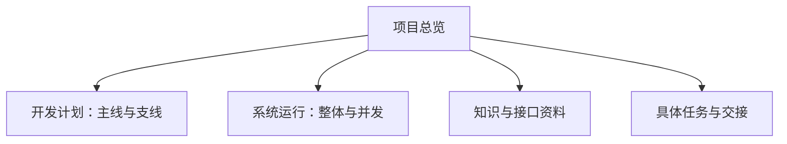

# Blog · 项目总览

> 本库为原始项目资料的展示副本。请修改源资料后重新导出。

## 项目框架

此图是资料导航结构，具体开发顺序和运行关系以项目原图为准。

## 导航

- [[01-流程图导航|开发计划与运行逻辑]]
- [[02-知识导航|知识与资料]]
- [[03-文件关系|文件引用关系]]

## 当前项目记录

- [[资料/TempMem|TempMem.md]]
- [[资料/preset|preset.md]]
- [[资料/todo|todo.md]]
